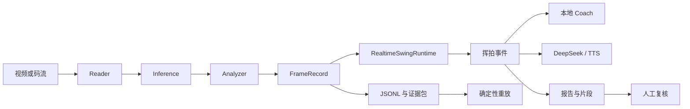

# Tennis Analyzer 项目结构与代码审查报告

- 审查日期：2026-10-17
- 分支：`algo-2.0`
- 提交基线：`20b4150`
- 范围：项目结构、核心流水线、算法与指标契约、控制台、报告、配置、依赖与自动化测试
- 性质：当前代码快照审查；本报告记录问题和建议，所列缺陷尚未在本次审查中修复

## 1. 总体判断

项目已具备“检测 → 挥拍事件 → Coach → 人工复核 → 证据重放”的完整本地分析闭环，可继续用于受控场景试用。

当前阶段应优先稳定工程边界和验证算法可信度。主要风险集中在控制台访问权限、会话生命周期，以及新增疲劳分析的证据门控。自动化测试较充分，但尚不能替代真实视频、跨机位准确性与长会话验收。

| 维度 | 当前判断 |
| --- | --- |
| 功能完整性 | 已形成较完整的本地分析和复核闭环 |
| 架构边界 | 主链路清晰，部分入口与控制模块职责过重 |
| 数据追溯 | 版本化记录、源时间、会话身份、证据清单与重放机制较完善 |
| 工程可靠性 | 有回归基础，仍存在访问控制、异步更新及清理竞态缺陷 |
| 算法可信度 | 投影代理与真实物理测量需要进一步区分，独立准确性验证不足 |
| 交付复现 | 依赖声明、安装流程、CI 和文档基线需要统一 |

## 2. 审查依据与验证范围

审查参考仓库 `AGENTS.md`、`docs/agents/`、`CONTEXT.md`、系统设计、需求基线、运维手册、指标计算契约及 ADR。

主要检查路径包括：

- 入口与运行时：`main_pipe.py`、`reader_runtime.py`、`frame_processor.py`、`realtime_swing_runtime.py`、`realtime_swing_pipeline.py`。
- 控制台与会话：`local_control_panel.py`、`static/js/`。
- 算法与统计：双视角生物力学、镜面几何、动力链、会话质量与会话总结。
- 产物与复核：报告渲染、人工复核工作流、证据清单与重放。
- 工程配置：依赖、安装脚本、测试组织、目录结构与文档。

本次为全项目结构梳理及核心链路重点审查，不代表对全部代码进行了逐行形式化验证。问题复现使用隔离数据、临时目录或替身对象，未读取或披露真实凭据。

未进行以下现场验收：

- 真实 RTSP 长会话、断网重连及长期资源占用。
- 真实扬声器连续播放与声音体验。
- 跨机位独立标注准确率、三维误差和疲劳识别准确性。

## 3. 当前项目结构

### 3.1 主链路

| 层级 | 主要模块 | 职责 |
| --- | --- | --- |
| 输入与控制 | `local_control_panel.py`、`main_pipe.py` | 配置、预览、会话启停、进程监督 |
| 读取与推理 | `reader_runtime.py`、检测器、姿态估计器 | 解码、帧调度、球拍与姿态推理 |
| 帧级处理 | `frame_processor.py`、候选与轨迹模块 | 坐标恢复、主球选择、观测记录 |
| 事件与指标 | `swing_event_*`、`swing_biomechanics.py`、`kinematic_sequence.py` | 分段、分类、触球候选、指标与证据资格 |
| 异步运行时 | `realtime_swing_runtime.py`、`realtime_swing_pipeline.py` | 日志、事件发布、旁路提交与产物更新 |
| Coach | `local_realtime_coach.py`、DeepSeek、TTS 模块 | 确定性建议、网络增强与语音 |
| 展示与复核 | `report_rendering.py`、模板、人工复核工作流 | 报告、标注、评估和人工边界重算 |
| 追溯与重放 | `session_evidence_bundle.py`、`replay_evidence_bundle.py` | 哈希、来源、重放与语义比较 |

### 3.2 规模与组织负担

基线统计：650 个受跟踪文件，319 个 Python 文件，约 76,487 行 Python；根目录 356 个文件，其中 130 个 `test_*.py`。Python 行数包含测试、脚本及历史代码，不等同于生产代码规模。

| 现状 | 影响 | 建议 |
| --- | --- | --- |
| 生产代码、实验、测试与一次性脚本大量集中在根目录 | 定位成本高，新旧入口易混淆 | 渐进建立应用、算法、运行时、报告、测试与工具目录 |
| `main_pipe.py`、`local_control_panel.py` 均超过 2,100 行 | 生命周期、配置和接口修改容易相互影响 | 优先拆分控制台鉴权、文件服务、会话管理及校准服务 |
| 报告模板已抽离，渲染层仍反向导入入口模块私有函数 | 模块依赖尚未完全解耦 | 抽出公共展示模型、格式化与证据展示函数 |
| 历史入口、模型实验、备份和旧总结并存 | 容易误判当前默认能力 | 明确主线入口，并给历史材料添加适用范围 |
| 95 个受跟踪文件位于 `data/analysis_results/` | 基准样本与生成产物的边界需要明确 | 区分固定测试证据、验收报告与日常会话输出 |

不建议一次性移动全部文件。应先修行为缺陷，再按依赖边界拆分，并保持现有 CLI 与数据契约兼容。

## 4. 已确认缺陷

优先级：P1 为应优先修复的问题；P2 为影响可靠性、状态一致性或结果表达的问题。以下代码链接行号对应本报告提交基线。

### R01 / P1：产物接口可读取项目内凭据文件

- 位置：[local_control_panel.py:840](../local_control_panel.py#L840)、[文件路由:1775](../local_control_panel.py#L1775)。
- 原因：路径校验仅限制在工作区内，没有限定公开产物目录，也未拒绝隐藏配置文件。
- 复现：临时工作区放置假凭据，无令牌请求 `/artifacts/.camera-credentials.local.env`，返回 HTTP 200 及文件内容。
- 影响：本机可访问该服务的调用方可能读取摄像头凭据或 `.env.local` 中的密钥。服务默认仅监听回环地址，不能据此推断为公网暴露。
- 建议：限定公开产物根目录；明确拒绝隐藏配置及其他非产物文件，并统一路径解析与权限校验。
- 验收：正常报告、视频及片段可访问；凭据、源码及越界路径无法通过产物接口读取。

### R02 / P1：镜面配置保存绕过控制令牌

- 位置：[local_control_panel.py:1791](../local_control_panel.py#L1791)。
- 原因：`/api/save_config`、`/api/mirror/save_config` 在 `X-Control-Token` 校验前执行写方法。
- 复现：隔离替换写入方法，无令牌 POST 返回 HTTP 200，写方法被调用一次。
- 影响：配置写入权限与其他控制接口不一致，可能改变 ROI、镜面和遮罩设置。
- 建议：所有具有副作用的路由先统一鉴权，再分派业务处理。
- 验收：缺失或错误令牌不调用写方法；有效令牌仍可正常保存。

### R03 / P1：疲劳分析绕过可比较性与机位门控

- 位置：[swing_session_quality.py:488](../swing_session_quality.py#L488)。
- 原因：疲劳区块没有沿用既有动作兼容性、事件重叠、机位尺度变化等比较限制。
- 复现：前 3 拍正手 1000 px/s、后 3 拍反手 500 px/s；主看板已返回 `monitoring_state=blocked`，疲劳区块仍返回 `FATIGUE_OBSERVED/-50%`。
- 影响：动作切换或人物尺度变化造成的速度差可能被当作疲劳。
- 建议：按动作、训练条件、测量方法和机位资格分组；比较不成立时返回阻断原因。
- 验收：混动作、重叠事件和尺度变化不产生疲劳结论；合格同组数据才计算趋势。

### R04 / P1：速度趋势混合 km/h 与 px/s

- 位置：[swing_session_quality.py:472](../swing_session_quality.py#L472)、[基线与近期取值:490](../swing_session_quality.py#L490)。
- 原因：逐拍使用 `kmh or px_s` 取数，丢失单位和测量方法身份。
- 复现：同为正手，前 3 拍 `contact_kmh=80`、后 3 拍 `contact_px_s=800`，输出 `ready/+900%/WARMED_UP`。
- 影响：历史数据与新数据混合读取时可形成无物理意义的趋势。
- 建议：保留单位、方法和标定身份；禁止数值回退后跨单位聚合。
- 验收：单位或测量方法不同的数据分组展示，不能形成同一速度均值或衰减率。

### R05 / P2：零测量样本仍宣称动作稳定

- 位置：[swing_session_quality.py:506](../swing_session_quality.py#L506)、[报告展示:784](../swing_report_builder.py#L784)。
- 原因：状态分支主要检查事件数，缺少合格测量样本和窗口覆盖条件。
- 复现：4 个缺少全部速度、动力链和肩角数据的事件，输出 `CONSISTENT`、`samples_evaluated=0`。
- 影响：报告会展示“动作节奏稳定”，将证据不足表达为正面结论。
- 建议：新增 `INSUFFICIENT_EVIDENCE` 等明确状态；以合格测量数判断资格。
- 验收：无数据、仅单侧窗口有数据及样本不足均不得显示稳定或疲劳结论。

### R06 / P2：SSE 遗漏已有事件的异步更新

- 位置：[local_control_panel.py:1675](../local_control_panel.py#L1675)。
- 原因：仅 `total_events` 变化才发送 `swings` 事件；正常 SSE 连接下前端关闭轮询回退。
- 复现：同一事件由 pending 更新为 ready，事件数量不变，未发送新的 swings 消息。
- 影响：TTS、DeepSeek、片段就绪等状态可能持续显示旧值。
- 建议：按 `session_id` 和快照 revision 或修改标识推送，不能只比较数量。
- 验收：数量不变的事件补丁可更新；切换会话后即使数量相同也刷新。

### R07 / P2：TTS 关闭异常导致后续资源清理中断

- 位置：[realtime_swing_runtime.py:136](../realtime_swing_runtime.py#L136)。
- 原因：TTS 关闭异常分支引用未导入的 `logging`。
- 复现：替身 TTS 的 `close()` 抛错，运行时随后抛出 `NameError`，输出管理器未关闭。
- 影响：后续 `output.close()`、`frame_journal.close()` 被跳过，最终产物收尾受到影响。
- 建议：补齐导入，并确保各资源独立收尾，单一旁路失败不跳过后续清理。
- 验收：故障注入后输出和帧日志均关闭，并保留原始错误信息。

### R08 / P2：快速重启时旧线程可覆盖新会话状态

- 位置：[local_control_panel.py:1554](../local_control_panel.py#L1554)、[临时目录清理:1581](../local_control_panel.py#L1581)。
- 原因：旧日志线程结束时，直接修改全局会话状态并清理当前运行目录，没有核对所属进程和会话身份。
- 触发：旧进程已退出、日志线程尚未收尾，此时启动新会话；旧线程随后执行收尾。
- 复现：隔离调用旧线程收尾条件，新会话临时运行目录被删除。
- 建议：线程捕获所属进程、会话 ID 和运行目录，仅更新或清理自身会话。
- 验收：旧线程延迟结束时，新会话仍保持正确状态，运行目录不被清理。

### R09 / P2：有效击球数实际统计可评分次数

- 位置：[swing_session_summary.py:191](../swing_session_summary.py#L191)、[输出字段:313](../swing_session_summary.py#L313)。
- 原因：`valid_shots_count = len(valid_scores)`。
- 复现：一个明确 `is_shadow_swing=False` 的正手事件，没有人工评分时，有效击球数为 0。
- 影响：当前自动评分禁用后，真实击球次数与页面统计容易不一致。
- 建议：分别返回非空挥事件数和可评分事件数，并清楚标注“非空挥”不等同于独立确认触球。
- 验收：无评分事件仍计入对应事件数量，可评分数量独立统计。

## 5. 算法与证据边界

### 5.1 新增三维命名超前于验证状态

[mirror_geometry.py:350](../mirror_geometry.py#L350) 的躯干估计使用默认 `k_x=1.65`、二维肩髋投影宽度推断 yaw；pitch 使用正面躯干线的图像倾角。该路径没有完成相机内外参、镜面位姿约束下的三维重建，也缺少独立三维参考误差基准。

当前应将其视为实验性投影代理。“真实 3D”“绝对旋转”和 `optimal` 等名称容易使使用者高估结果可信度。合成样本符合预期公式，不能单独证明真实三维测量准确性。

建议：

- 明确记录方法、默认尺度或标定来源、适用机位、验证状态和已知限制。
- 在报告、OSD、JSON 和 Coach 中保持一致的代理指标身份。
- 独立验证前限制其技术指导资格，不以检测置信度替代物理测量准确率。

### 5.2 应延续已有的保守契约

已有动力链模块明确保留 `accuracy_validated=False`、`coach_eligible=False`；源媒体时间、原始观测身份、缺失观测与测量窗口的契约较成熟。当前自动技术评分曲线禁用、人工确认评分保留，也符合已有证据边界。

新功能应复用这些资格规则。疲劳分析尤其需要区分“速度观察值下降”和“体能疲劳”；固定百分比阈值尚不足以证明生理原因。

## 6. 工程与文档状态

### 已具备的基础

- Reader、Inference、Analyzer 有进程监督，异常退出能够向上反馈。
- 事件分析、报告、网络建议和语音具备异步边界。
- FrameRecord、SwingEvent、会话身份和事件日志有版本化与追溯设计。
- 证据包记录哈希和来源，支持从帧记录开始重放确定性事件及本地 Coach。
- 人工复核保留原事件，未完整复核时不直接发布最终评估结论。

### 尚需统一的交付基础

| 问题 | 建议 |
| --- | --- |
| `requirements.txt` 未声明报告必需的 Jinja2，也未覆盖主线 Core ML 依赖 | 统一依赖文件和安装脚本，区分核心运行、开发测试及独立 TTS 环境 |
| 主视频环境依赖缺少完整锁定 | 记录已验证 Python、依赖、模型与配置版本，并在干净环境执行安装验收 |
| 未发现受跟踪的 GitHub Actions 工作流 | 建立统一测试入口并接入 CI，硬件相关测试与纯逻辑回归分开执行 |
| 自动回归与模型演示、诊断脚本混杂 | 明确测试目录、执行方式、硬件要求和是否产生输出 |
| README、系统设计、运维文档仍保留旧分支或旧代码基线 | 更新当前主线与适用能力，保留历史材料但注明状态 |
| 本次查询 GitHub 未关闭 Issue 列表为空 | 将确认缺陷、独立验证任务与模块化任务纳入正式跟踪 |

## 7. 本次验证结果

| 检查 | 结果 |
| --- | --- |
| 103 个 unittest 模块 | 835 项测试通过，标准命令执行约 27.85 秒 |
| ROI 几何前端测试 | 通过 |
| ROI 码流绑定前端测试 | 通过 |
| 319 个受跟踪 Python 文件语法检查 | 全部通过 |
| 四个主要前端 JavaScript 文件语法检查 | 全部通过 |
| 缺陷反例验证 | 部分边界通过临时数据或替身对象隔离复现 |
| 审查后工作区检查 | 写入本报告前工作区无变更 |

首次以标准输入脚本启动回归时，多进程 spawn 测试出现一项失败；改用标准 `python -m unittest` 命令后，835 项全部通过，因此未将首次失败列为项目缺陷。

本次自动化集合由根目录包含 unittest TestCase 的 103 个模块组成，不等同于运行了全部模型演示和诊断脚本。测试通过证明所覆盖行为满足回归断言，不证明检测准确率、三维精度、疲劳识别或现场稳定性。

## 8. 下阶段实施建议

### 阶段一：修复确定性缺陷

优先处理 R01、R02、R03、R04，随后完成 R05–R09。

验收条件：

- 产物服务只能暴露明确允许的文件。
- 所有配置写入接口统一鉴权。
- 疲劳区块不跨单位、动作、机位尺度或不可比较数据下结论。
- 零测量样本明确显示证据不足。
- 旧线程不影响新会话，旁路关闭失败不阻止其他资源收尾。
- 同数量事件的异步补丁能够更新页面。
- 击球事件数与可评分次数独立表达。
- 为上述边界补充针对性回归，原有测试继续通过。

### 阶段二：建立可复现交付基线

- 统一核心依赖、开发依赖和独立语音环境说明。
- 固化已验证的 Python、依赖、模型哈希与配置快照。
- 提供一条标准回归命令，并接入 CI。
- 更新 README、系统设计、运维与当前功能状态。
- 为确认缺陷和验证任务建立带验收条件的 GitHub Issues。

验收条件：在干净环境按文档安装，能启动控制台、运行固定输入、生成并验证证据包。

### 阶段三：完成真实输入与独立准确性验证

- 按场地、动作、遮挡、移动和人物尺度组织固定原始视频集合。
- 区分原始视频与带覆盖层视频，分别验收检测和覆盖层恢复。
- 分别统计事件漏检、误检、动作分类、触球帧偏差与拒绝结论比例。
- 独立记录输入帧率、处理吞吐、事件发布延迟及资源增长。
- 执行 RTSP 断流重连、长会话、TTS 连续播放与退出验收。
- 三维代理先与独立参考比较，验证误差及适用范围后再决定是否开放技术结论。

验收条件：验证集、标注来源、代码与模型版本可追溯；指标阈值基于实测基线确定，不能用输出 FPS 或合成回归替代。

### 阶段四：渐进模块化

建议顺序：

1. 控制台鉴权、文件服务与会话生命周期。
2. 校准路由与校准服务。
3. 主流水线的配置装配、进程监督与业务处理。
4. 报告公共展示模型和格式化函数。
5. 测试、工具、实验及历史代码归档。

验收条件：每次拆分保持外部入口和版本化数据契约兼容；不将结构迁移与算法阈值变化混在一次改动中。

### 阶段五：在证据基础上扩展算法

继续开发三维解释、疲劳判断和自动评分前，应先明确操作定义、来源与误差验证方式。优先交付能够重复运行、结果可复核、证据不足时明确拒绝结论的稳定版本。
