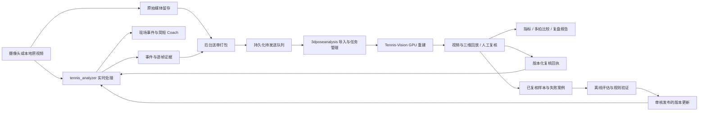

# Tennis Analyzer 与 3D Pose Analysis 协作方案

日期：2026-10-17。状态：设计建议，尚未实施跨项目集成。

本方案结合 Tennis Analyzer 的项目审查，以及 `/Users/krum5539/Documents/3dposeanalysis` 当前工作区的 README、数据格式、分析、导入和存储实现。3dposeanalysis 当前包含未提交的功能变更，本方案描述的是所查看的工作区能力，不代表全部已发布或重新验收。

## 1. 产品定位

建议形成“训练现场即时反馈 + 训练结束后深度复盘”的双端闭环。

- **tennis_analyzer：现场训练助手。** 快速识别挥拍、记录片段和证据、提供有依据的简短提示，帮助用户完成当次训练。
- **3dposeanalysis：后期审查工作台。** 对选定动作进行三维回放、阶段修订、数据质量检查、指标与曲线分析、同条件多拍比较和教练复核。
- **Tennis-Vision：离线重建计算模块。** 继续由 3dposeanalysis 调用现有 GPU Worker，承担人体、球拍、镜面和贴图处理。

两端共享同一训练会话、动作身份和证据来源；分别维护实时结果与复核结果。离线作业的排队、耗时或失败不影响现场识别与提示。

目标用户流程：训练时看到“刚才发生了什么、有哪些可行动提示”，训练后看到“为什么这样判断、证据是否充分、与同条件动作相比如何”。

## 2. 现有能力与可复用基础

| 项目 | 当前可复用能力 | 需要新增的协作能力 |
| --- | --- | --- |
| tennis_analyzer | 多进程实时推理、事件识别、本地 Coach、异步语音、逐帧 JSONL、证据 manifest、人工复核、重放 | 离线送审包、原始媒体保留策略、动作来源绑定、送审状态和复核回执展示 |
| 3dposeanalysis | pose3d JSON/NPZ 导入、源哈希检查、视频/三维同步回放、阶段编辑与修订冲突检查、37 项基础指标、标定后 4 项指标、质量诊断、多拍比较、报告 | 接收实时端候选事件、帧映射适配、来源面板、回执导出、定位指定来源动作 |
| Tennis-Vision | 3dposeanalysis 已通过 SSH Adapter 调用 GPU 视频处理流程 | 必要时补充原始视频到标准化视频的逐帧来源记录 |

Tennis Analyzer 已有 `cross_project_evidence.py` 和 `scripts/build_cross_project_review.py`，可按视频哈希、源帧身份和重建元数据生成对照页。这套实现连接的是 Analyzer 与 Tennis-Vision 的既有结果，**不是已经完成的 3dposeanalysis 导入接口**。可复用其来源核验原则与反例测试，再增加面向 3dposeanalysis 的 Adapter。

当前关联页提供对应帧号和 Viewer 入口，尚未实现两个项目播放器的自动同步。

## 3. 职责分配

| 事项 | 实时端负责 | 后期端负责 | 共同约定 |
| --- | --- | --- | --- |
| 视频采集 | 持续读取，保留可审查的原始媒体与帧身份 | 读取指定片段，必要时产生标准化副本 | 原始媒体与派生媒体分别记录哈希和帧映射 |
| 挥拍定位 | 自动产生候选起止、触球和峰值 | 核对、细化、补标或排除候选 | 自动候选不自动变成人工确认 |
| 姿态与球拍 | 使用轻量模型满足现场时延要求 | 运行重建、拟合与多处理分支 | 原始观测、模型估计与人工标注保留来源 |
| 指标 | 只计算现场有价值且证据合格的指标 | 计算阶段曲线、三维运动学及峰值区间 | 同名指标必须核对定义、单位和坐标系 |
| 教练反馈 | 简短、低延迟、可行动的提示 | 结合证据形成较完整的复盘与训练建议 | AI 草稿与教练确认分开保存 |
| 评分 | 使用明确合格的规则或人工评分 | 管理人工评价、标定与规则验证 | 未验证规则不自动发布到实时端 |
| 数据持久化 | 实时原始日志和事件版本 | 离线计算版本、人工修订与复核报告 | 两边不直接改写对方的数据目录 |

## 4. 推荐协作架构



### 4.1 第一版采用证据包交换

优先实现文件导出与导入，让一次完整交接可以保存、复现和排错。随后再把同一接口接到本地 HTTP 与后台任务队列。

实时主循环只发布已有事件及送审意图。视频裁剪、文件哈希、上传和重建调度放在后台执行；队列满或媒体不足时明确显示待处理或送审不可用。后台任务使用原子发布的完整包，避免后期端读到半写入产物。

建议交接目录结构：

```text
review_package/
  manifest.json          # 协议、会话、媒体、版本与文件完整性
  events.json            # 候选动作及来源身份
  frame_map.jsonl        # 原始、裁剪、标准化视频之间的来源关系
  observations.jsonl     # 所选窗口内实时观测，保留来源与质量
  media/
    source_clip.mp4      # 无 OSD 的审查输入；或受管理媒体引用
  context.json           # 场地、人物、惯用手、任务与机位标定引用
```

原有 replay manifest 可以被交接包引用，但不能当作交接包的全部内容。原有确定性重放最低只需要帧日志与事件快照；三维重建还需要可读取的媒体像素。

### 4.2 第二版增加后台任务联动

用户在实时报告中选择“送到三维复盘”，后台提交并立即返回任务编号。实时端仅展示状态及报告入口，任务生命周期由后期端管理。

建议任务状态：`queued → preparing_media → reconstructing → analyzing → ready_for_review → reviewed`，另设 `failed` 和 `cancelled`。每次重试沿用明确的任务身份；重算产生新的计算版本。

交接键可采用包哈希加目标处理配置哈希，以防网络重试重复创建同一计算任务。标注修订与计算任务分开编号，修改教练备注不应触发重新重建。

## 5. 必须先统一的数据约定

### 5.1 会话、动作与来源身份

| 字段 | 用途 |
| --- | --- |
| `contract_version` | 交接协议版本，和两项目内部 schema 独立 |
| `session_id` | 一次训练会话，跨项目保持稳定 |
| `origin_event_id` | 实时端事件身份，与 session_id 组合唯一 |
| `review_case_id` | 后期复核事项，可关联一个或多个来源事件 |
| `subject_id` | 场次内的人物身份；人物不确定时禁止自动合并 |
| `source_video_sha256` | 原始输入媒体字节身份 |
| `derived_video_sha256` | 裁剪或标准化视频身份 |
| `pose_data_sha256` | 三维导出数据身份 |
| `analysis_version` | 模型、公式、滤波参数与标定版本 |
| `annotation_revision` | 人工标注修订版本 |

特别注意：3dposeanalysis 的 `PoseData.source_hash` 当前是 **pose3d.json 的哈希**，另有 `video_hash` 表示视频哈希。跨项目协议不能把所有 `source_sha256` 当成同一种来源；Adapter 应显式映射命名。

### 5.2 时间轴与帧映射

这是第一优先级的接口工作。

3dposeanalysis 当前视频生成路径使用 FFmpeg `fps=25` 标准化；Tennis Analyzer 的直播处理可能跳过过期帧。实时日志第 N 条、原视频第 N 帧和三维结果第 N 帧因此不一定对应。

建议每条派生帧记录包含：

- 原始视频哈希、源帧号、源 PTS 与时间基准。
- 裁剪后帧号及该帧对应的原始帧身份。
- 标准化后帧号、输出 PTS 及所选输入帧身份。
- 是否重复选帧、是否插值、来源是否可验证、映射工具与版本。

映射必须在裁剪、解码和标准化过程中产生，并保留重复或缺失关系。禁止通过“时间乘以平均 FPS”宣称精确对应。若当前工具无法给出可靠逐帧来源，只能标记粗略时间定位或待映射，并暂停跨项目精确峰值比较。

直播端目前没有已验证的设备媒体时钟时，应保留该限制。以接收时间辅助选片可以明确标记为估计，但不能据此宣称曝光时间同步。

### 5.3 阶段映射

| 实时端候选 | 后期端目标 | 转换规则 |
| --- | --- | --- |
| `start_frame` | `start` | 在帧映射验证后作为草稿起点 |
| `contact_frame` | `contact_start` / `contact_end` | 作为候选锚点，人工确认范围；不能自动变为 confirmed |
| `peak_frame` | 来源附加证据 | 保留运动峰值含义，不直接替代前挥开始或真实触球 |
| `end_frame` | `end` | 在映射验证后作为草稿终点 |
| 已有准备/前挥/随挥阶段线索 | `forward` / `follow_end` | 仅有明确依据时提供候选，否则待复核 |
| 自动动作类别 | `shot_type` | 显式枚举映射，未知类别保留 unknown |
| 自动空挥判断 | `contact_status` | 保留候选来源，最终状态由复核确认 |

3dposeanalysis 当前事件结构要求完整阶段字段。第一版应增加“导入候选待补全”的中间记录，由用户补齐后转为合法事件，不能为了通过校验而编造 `forward` 和 `follow_end`。惯用手或人物身份缺失时同样等待确认。

### 5.4 指标语义

两边共享指标描述协议，保留各自算法实现。

每项指标至少携带：指标 ID、操作定义、坐标系、单位、测量方法、阶段窗口、有效样本、质量状态、公式版本及验证状态。

例如：

- 实时肩线投影角与离线三维躯干角属于不同指标。
- 实时拍框中心像素速度与离线模型拍头速度不能合并计算。
- 模型米与实测米分别标注。
- 三维模型与实时模型相互一致，只能说明模型结果的一致程度，不能自动视为独立真值。

界面可并排呈现两边指标和定义差异；只有空间、时间、单位及测量定义一致时才计算数值偏差。

## 6. 原始媒体保留策略

实时端当前的标注视频、OSD 片段与 JSONL 不能完整替代三维重建需要的干净原视频。送审能力必须与媒体留存策略一起设计。

建议提供三种用户选项：

1. **保留整段原视频**：适合验证阶段及需要完整训练复盘的场次。
2. **保留候选动作原始片段**：使用有界原始视频缓存，保存事件前后上下文；节省存储。
3. **仅实时反馈**：不保留媒体，结束后明确显示三维重建不可用；若已有事件日志，可保留日志重放能力。

缓存应覆盖候选动作开始到确认发布的延迟，再加动作前后上下文。不要只按固定几秒容量假设所有事件都能完整留存。场地全景、镜面和标定需要的区域也应保留，不能只保留裁掉镜面的选手特写。

长会话按动作或短段送审，以适配当前后期视频入口的 120 秒限制。片段需要适当重叠和来源映射，避免裁剪掉准备、随挥和回位。实时动作尚未结束时不提前把片段标记完整。

原始媒体采集、推理与归档应有独立资源预算。归档失败应显示送审证据不完整；不把归档上传放到推理循环中等待。

## 7. 用户可见的交集

### 7.1 实时端

每次挥拍保留现场提示与事件卡，增加：

- “加入复盘清单”。
- “送到三维复盘”。
- 送审进度、失败原因和重试入口。
- “打开已完成复盘”，直接定位该动作。

初期按用户选择送审。后续可提供“抽样送审”和“低证据事件优先复核”，并允许用户选择。三维处理量不随每一帧或每一次状态补丁增加。

### 7.2 后期端

新增“来自现场训练”的入口，显示会话、动作、原片、自动分类、现场提示和质量警告。完成来源核验后，在同一时间位置查看原始视频、实时观测和三维重建。

建议分三步复核：

1. **事件与数据复核**：是不是有效动作，阶段和触球候选是否正确，是否存在遮挡、丢帧或拟合缺失。
2. **运动学分析**：查看三维指标、曲线、滤波敏感性和峰值区间。
3. **训练复盘**：同条件多拍比较，教练记录问题、建议和待验证事项。

### 7.3 返回实时端

回传只包含可追溯的摘要与链接：复核状态、修订版本、确认的动作或阶段、教练备注、报告位置和对应来源。

实时端并列展示“现场自动结果”和“后期复核结果”。原始现场记录保持可追溯，后期修订形成独立版本。后期修改再次发生时，旧回执标记为历史版本。

## 8. 反馈如何改进实时端

建议建立三层反馈：

| 层级 | 内容 | 应用方式 |
| --- | --- | --- |
| 事件反馈 | 漏检、误检、动作类别、触球范围和阶段修订 | 进入独立事件评估与失败样本集合 |
| 观测反馈 | 球/拍/关节缺失、镜面混淆、人物身份、时间映射异常 | 指导检测、选择器与观测质量规则改进 |
| 教练反馈 | 人工评价、训练条件和建议有效性 | 用于规则验证及个人长期复盘 |

复核记录不直接自动调节正在运行的阈值。建议执行“收集 → 分组评估 → 留出验证 → 审核发布 → 新会话使用”的版本流程。训练与验证样本按运动员和场次隔离，避免同源片段同时进入开发与验收集合。

后期三维重建属于模型估计，其结果可以帮助发现问题和提出候选标注；未经独立确认，不直接作为实时模型的真值标签。

## 9. 工程实施范围

### tennis_analyzer 建议新增的 Module

- `review_export`：从既有事件与媒体生成完整送审包，隐藏裁剪、来源校验和 manifest 组装。
- `review_outbox`：持久化待发送任务、重试与状态；对实时调用者只暴露提交和查询 Interface。
- `review_receipts`：校验后期回执来源、事件身份和修订版本，并供报告展示。

### 3dposeanalysis 建议新增的 Module

- `analyzer_import`：作为 Adapter，验证送审包、映射身份和帧号、保存待补全候选，并对接既有视频与数据导入。
- `review_export`：输出绑定数据来源和标注修订的复核回执。
- 来源导航：按会话、来源事件和复核事项定位工作台页面。

协议先采用 JSON Schema、示例包和双端契约测试。保持现有 Python 3.9 实时环境与 Python 3.11+ 后期环境独立；不以共享运行环境或互相导入内部 Python 文件作为集成前提。协议稳定且重复代码确有维护成本后，再考虑提取小型公共库。

建议初期保持两个仓库、两个应用入口、一个协作协议。现有重建 Worker 由后期端统一管理，避免两个项目分别维护 GPU 调度与贴图逻辑。

## 10. 实施阶段与验收

| 阶段 | 交付内容 | 验收条件 |
| --- | --- | --- |
| A：稳定基础与冻结协议 | 修复当前访问控制、清理、会话竞态和异步状态问题；确定身份、媒体、帧映射与阶段协议 | 敏感文件不通过交接暴露；重复任务、错来源及不完整包能明确拒绝 |
| B：本地文件闭环 | 一个已录制干净视频的实时分析、送审导出、后期导入、事件草稿与来源定位 | 同一动作能定位到正确源帧；转码存在时逐帧映射可验证；未知阶段不伪造 |
| C：复核回执 | 后期阶段修订、教练记录、回执导出及实时报告显示 | 修订冲突被拒绝；回执不覆盖实时原始结果；重复导入不重复创建事项 |
| D：一键异步送审 | 实时按钮、持久化队列、GPU 作业状态、报告深链和失败重试 | 后期不可用或任务积压时实时链路继续运行；恢复后可重试且不重复计算 |
| E：直播媒体与持续改进 | 原始片段缓存、丢帧与时间映射、抽样复核、失败样本与版本评估 | 不完整片段明确标记；资源占用有界；规则更新经过独立验证再发布 |

第一版建议选择一个已有本地原视频、一个场地和一种动作，跑通 B 与 C。这样能先验证最重要的来源、阶段和修订交接，再扩展直播采集与自动送审。

## 11. 建议的第一版验收清单

- [ ] 同一训练会话和动作在两个项目中具有可追踪的关联身份。
- [ ] 视频哈希、三维数据哈希和标注修订分别记录。
- [ ] 从实时报告可定位后期复核事项，后期页能返回实时证据。
- [ ] 源帧、裁剪帧、标准化帧关系可查；无法验证时不显示精确同步。
- [ ] 接收实时候选后保持草稿状态，人工补齐阶段后才能进入正式复核。
- [ ] 没有视频时清楚说明重建不可用，不把 JSONL 重放误当作三维重建。
- [ ] 后期失败、重试和重复提交不影响实时处理。
- [ ] 复核回执只追加版本，不改写原始事件和媒体。
- [ ] 实时二维代理与离线三维模型指标不跨单位或定义混算。
- [ ] 对比一键送审开关前后的现场吞吐、延迟和资源占用，以实测决定资源预算。

## 12. 参考实现与文档

- [当前项目审查报告](PROJECT_REVIEW_20261017.md)
- [Analyzer 与 Tennis-Vision 同源证据关联](CROSS_PROJECT_EVIDENCE.md)
- [指标计算契约](METRIC_CALCULATION_CONTRACT.md)
- [源媒体时间 ADR](adr/0003-source-media-time-contract.md)
- [3dposeanalysis 项目说明](../../3dposeanalysis/README.md)
- [3dposeanalysis 指标定义](../../3dposeanalysis/docs/METRICS.md)
- [3dposeanalysis 阶段事件格式](../../3dposeanalysis/schemas/event.schema.json)
- [3dposeanalysis 视频导入实现](../../3dposeanalysis/src/pose_analysis/video_import.py)
- [3dposeanalysis 来源与修订存储](../../3dposeanalysis/src/pose_analysis/store.py)

后期端的已有能力依据当前代码与文档核对，本轮未重新运行其自动化或真实 GPU 作业。各阶段验收项是实施目标，不代表已经通过。
