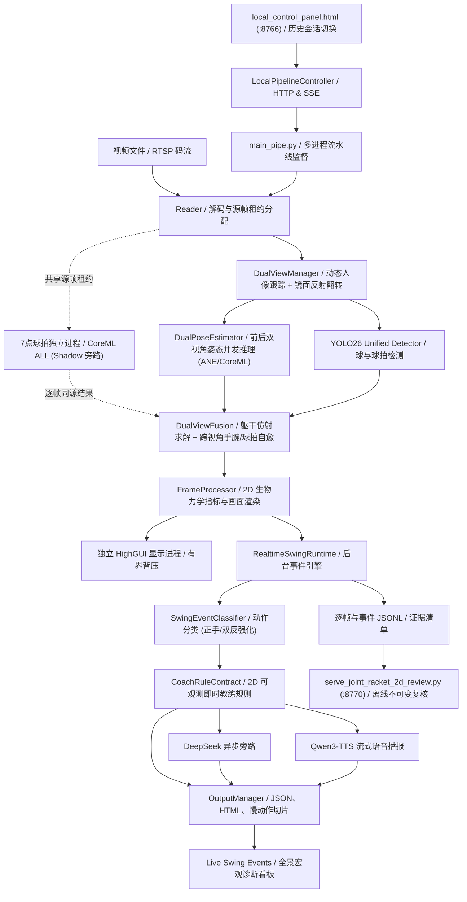

# 系统设计与算法流程

更新：2026-11-15。当前基准整合了 [640 Shadow stable](releases/640-shadow-stable-20261019.md) 与 **Algo 2.0 虚实双视角融合架构**；本文同步当前系统架构、前后端接口与核心算法边界。

## 1. 系统边界

面向 Apple Silicon 本机、单机位 + 镜面反射的室内网球训练智能分析。推荐分析入口为 `main_pipe.py`，控制入口为 `local_control_panel.py`。一个控制器管理一个分析会话；Court 01–03 是可切换的机位配置。

系统核心由两套 Web 服务协同组成：
1. **实时控制面板 (`http://127.0.0.1:8766/`)**：负责 RTSP/本地视频实时分析启停、ROI/镜面标定映射、击球动作卡片流、五维模型雷达图、共性短板归纳、50+ 历史会话自由回溯及慢动作切片复盘。
2. **2D 联合复核服务 (`http://127.0.0.1:8770/`)**：基于不可变 SHA-256 哈希校验的离线人工标注与逐帧触球复核工具，支持双机位同屏拼接（1280×680 锁定比例与事件级自适应视窗裁剪，杜绝缩放抖动）。

前端采用静态 HTML、原生 JavaScript 与生成式报告；后端是 Python 多进程分析流水线，状态/日志/事件使用 SSE，失败时回退 HTTP 轮询；不依赖外部数据库、Node.js 运行时或重型前端框架。

## 2. 运行架构

| 模块 | 职责与约束 |
| --- | --- |
| `main_pipe.py` | 共享内存、多进程管道监督；支持 `buffered`、`realtime`、`offline` 三种调度模式 |
| `dual_view_manager.py` | 动态人像 3:4 比例自适应追踪，后墙镜面区域多边形提取与水平镜像翻转 |
| `dual_pose_estimator.py` | 默认正背 2 合 1 拼图单次 `yolo26m-pose` CoreML 推理（`pose_stitched_single_pass: true`），支持回退正反双实例并发推理 |
| `dual_view_biomechanics.py` | 躯干四边形仿射变换、跨视角手腕互投自愈（`allow_recovered=True`）、7 点球拍跨视角投影、2D 规则指标计算 |
| `swing_event_classifier.py` | 挥拍动作分类器；集成双反家族比例（`bh_family_ratio >= 0.55`）与自愈姿态，杜绝镜面双反判 Unknown |
| `coach_rule_contract.py` | 2D 可观测规则评估（转肩、引拍、击球手臂舒展、重心前移、平衡稳定等），即刻输出诊断标签 |
| `racket_pose_runtime.py` | 独立 7 点球拍进程，同源帧合同，640 Shadow 模式安全隔离 |
| `local_control_panel.py` | 本地控制台后端；支持 `/api/sessions` 历史枚举、`/api/session/events?session_id=...` 精准回放 |
| `serve_joint_racket_2d_review.py` | 2D 联合复核服务器；严格验证源视频 SHA-256，生成不可变人工触球收据 |
| `frame_processor.py` | 汇总逐帧运动分析结果 |
| `realtime_swing_runtime.py` | 异步事件处理、日志与旁路提交；队列满时可反压 |
| `realtime_swing_pipeline.py` | 滚动事件、片段缓存、事件快照、HTML 与异步更新 |
| `manual_review_workflow.py` | 标注校验、评估、人工边界重算及对比 |

异步不等于绝对无阻塞：日志队列反压、快照复制、磁盘与共享硬件资源都可能影响时延。2026-09-20 更新：TTS 请求加入等待期限与取消；报告只保留一个待写快照。

## 3. 检测与算法链路

### 3.1 检测层

1. 默认`buffered`在模型及窗口预热后开始读取，保留所有已解码源帧；三个源槽满时背压，不重置落后的名义输入节奏。`offline`逐帧且不节流，只有显式`realtime`允许丢旧帧。上游摄像头/网络丢失不在本地解码完整性证明范围内。
2. 根据实际机位解析球场ROI、正面与镜面配置；双人体分别使用相应视图裁剪。球场过滤、模型输入裁剪与显示ROI是不同环节，不能认为所有模型共用一个四边形裁剪。每路结果恢复原图坐标，并记录裁剪及输入几何。本地视频绑定机位才继承摄像头ROI。
3. 默认`tennis-yolo26n-exp004-960-fp16`以960 letterbox输入、`ANE`运行，类别`ball=0`、`racket=1`，阈值分别0.692/0.524；它不承担人体姿态。Shadow保留该旧球/球拍业务选择。
4. `yolo26m-pose` 以 640 模型输入和 Core ML `ALL` 输出人体关键点；默认启用 `pose_resize_policy: direct_source` + `pose_preprocess_mode: letterbox` + 浮点亚像素与 `pose_stitched_single_pass: true`（正/背 2 合 1 拼图单次推理），并保留配置开关可回退 `legacy` 或双实例路径。
5. 显式`640_shadow`额外加载640/ALL七点模型，只记录/显示旁路观测，不能一次输出人体与球拍。正式七点仍取全源帧独立letterbox，ROI/镜面分区裁剪是未采用实验。正式组合为`barrier + shared_memory`，逐帧等待七点同源结果；进程失败/超时使本轮失败。基础默认仍为`legacy/barrier/queue`，不是自动切换到640。
6. 主球选择结合轨迹支持、速度预测、球拍距离及镜像区域惩罚；静止锚点用于抑制背景球。重捕获窗口配置为 8 帧。
7. 球拍候选结合球位置、历史连续性和镜像惩罚重排。覆盖层恢复可从已标注视频中恢复球圈和球拍框，来源保留为 `overlay_*`；这种视频不能直接用作纯检测准确率验收。

### 3.2 虚实双视角融合与跨视角姿态自愈

在室内配备全景后墙镜面的场地（如 Court 02 / Camera 04），系统通过 `DualViewManager` 动态抽取正面真人（Front）与镜像翻转的背面虚像（Back）。
针对侧身击球与大幅度引拍导致的严重肢体遮挡，`dual_view_biomechanics.py` 实现了两级跨视角自愈机制：

1. **躯干仿射变换与残差监控**：
   - 提取正反双视角共有的躯干 4 点（左肩、右肩、左髋、右髋），最小二乘拟合正面与背面间的仿射映射矩阵 $M_{\text{front}\leftrightarrow\text{back}}$；
   - 实时计算仿射残差 RMSE（正常范围在 8~15px），过滤姿态剧烈形变或关键点跳变异常帧。
2. **跨视角手腕互补自愈 (`allow_recovered=True`)**：
   - 当正面视角持拍手手腕被躯干遮挡时，从无遮挡的背面镜像中提取手腕关键点，经逆向仿射投影重构正面手腕空间坐标；
   - 补全后的手腕保留 `is_recovered=True` 溯源标记，使下游的挥拍动力学链计算和分类器避免盲区断裂。
3. **七点球拍跨视角找回与投影 (`dual_view_fusion`)**：
   - 优先通过手腕—握把距离候选找回原生七点球拍检测（Rescue 原生球拍）；
   - 双视角原生均不可见时，将对侧可见的 7 点球拍仿射投影至当前视角（标明 `projected, v=1`）。
4. **2D 可观测重点生物力学指标体系**：
   - 引入肩宽/脊柱收缩比 $\rho$（反映身体转体与侧身程度）、拍杆像面方向角、肘膝夹角、甜区刷球角（低到高像面角与下掉深度比）等高价值 2D 代理指标。

### 3.3 挥拍动作分类与双手反拍（双反）稳健性

`swing_event_classifier.classify_shot()` 与 `swing_event_analyzer` 负责对分割出的挥拍动作进行多维分类与置信度打分：
1. **双手反拍识别增强**：
   - 针对近景反拍导致双腕握把间距轻微放大的场景，引入反手家族特征比例统计（`bh_family_ratio >= 0.55`）；
   - 在置信度不足时，优先依据击球侧向、引拍轨迹与躯干轴投影判定反手，彻底解决双手反拍被传统硬阈值判定为 `Unknown` 的死胡同。
2. **2D 即时教练规则契约 (`coach_rule_contract.py`)**：
   - 对转肩幅度、引拍深度、击球臂舒展角、重心转移与平衡稳定性等关键动作建立可观测阈值体系，即刻输出确定性评价（`pass` / `ok` / `warn`）与紧凑教练口令。

### 3.4 帧率与时间

`analysis_interval_frames=5` 表示每 5 个已处理帧执行一次滚动分析。CLI 未指定结束等待时，主配置 `settle_frames=null` 按源 FPS 计算约 0.6 秒；控制面板默认提供 15 帧。它们与 `output_fps`、实际推理吞吐是不同概念。

15FPS是历史目标；正式640 Shadow本地验收要求输出≥25FPS、名义输入到输出P95≤250ms、源帧完整且无持续积压。设置`output_fps=25`不保证吞吐；启动、稳态、源PTS、HighGUI返回、网络和首声时延分开记录。

冻结M5/32GiB构建完成27/27短片、15,250帧长测（稳定25.069FPS、P95 88.6ms、RSS增长3.28%）、9/9业务对照、固定7轮故障复验及133项定向回归。名义调度延迟不是曝光到屏幕时延，完整范围见[正式版本说明](releases/640-shadow-stable-20261019.md)。

### 3.5 Coach 与语音

本地 `LocalRealtimeCoach` 根据证据门控生成最多 3 条建议，默认每条最多 15 字；生物力学代理指标不等于真实三维测量。球/拍证据不足应限制相应结论，不必禁止所有可靠的姿态建议。

DeepSeek 接收结构化事件和逐帧证据，异步回写 `pending/ready/failed/unavailable`，不参与确定性重放。Qwen3-TTS 只播报本地建议，经 Python 3.11 worker 流式生成并保存 WAV；浏览器音频控件播放生成文件，本机实时出声由 worker 的音频设备完成。

## 4. 前后端功能与接口

| 页面 / 端口 | 功能 |
| --- | --- |
| **控制面板 (Port 8766)** | 场地/自定义流、临时凭据、ROI 预览与显示参数、会话启停、实时日志、Coach/TTS/DeepSeek 开关、报告入口 |
| **Live Swing Feed** | 实时击球卡片、**历史会话快速切换**、行内慢动作（1.0x/0.5x/0.25x 逐帧前进后退）、全屏弹窗复盘、五维模型雷达图、全景宏观诊断看板 |
| **2D 联合复核工具 (Port 8770)** | 双视角同屏拼接播放（1280×680 锁定比例与稳定裁剪防抖）、连续丢帧重点定位、人工触球区间与锚点确认、SHA-256 强校验不可变收据导出 |

| 方法 / 路由 | 后端行为 |
| --- | --- |
| GET `/` | 控制面板 HTML |
| GET `/api/config` | 场地、默认参数、当前控制令牌 |
| GET `/api/status` | 会话状态、PID、加载时service_build、日志、产物入口 |
| GET `/api/sessions` | **历史训练会话列表**（包含会话ID、时间戳、挥拍数、源视频名与活动标识） |
| GET `/api/session/events` | 挥拍事件列表；支持 `?session_id=...` 精确检索历史会话卡片与慢动作切片 |
| GET `/api/session/summary` | 会话全景诊断；支持 `?session_id=...` 检索宏观短板与质量趋势 |
| GET `/api/events`、`/api/sse` | SSE 状态、日志和挥拍事件；前端连接失败回退轮询 |
| GET `/api/live-preview` | 当前会话预览图 |
| GET `/artifacts/...` | 会话产物、逐拍慢动作 MP4 与触球定格图（支持 HTTP 206 范围请求播放） |
| GET `/api/manual-review/state` | 指定报告的校准状态 |
| POST `/api/preview` | 按输入配置抓取 ROI 预览 |
| POST `/api/start`、`/api/stop` | 启动或停止分析流水线 |
| POST `/api/manual-review/evaluate` | 校验标注、生成评估及满足条件时重算 Coach |

POST 需要 `X-Control-Token`；校准可用 `X-Manual-Review-Report` 定位报告。服务绑定本机回环地址。前端通过 HTTP 和 SSE 访问后端，SSE 不可用时轮询；本地预设不保存摄像头密码。停止页面刷新只停止浏览器读取，不停止后端分析。

## 5. 数据与校准闭环

每个控制台会话有独立目录和 session_id；FrameRecord、SwingEvent 及文档有版本字段。JSON/HTML 是快照，JSONL 为追加历史。证据包记录路径、尺寸、SHA-256 和重放参数，最低重放集合为 frame journal + event snapshot，遵循 ADR 0001/0002。

人工校准依次读取事件和帧日志、校验标注、写评估；完整复核条件满足后才生成人工事件和 Coach 对比。原实时事件保留。人工标注不会自动微调 YOLO、修改规则或触发 DeepSeek 重评；这些需要独立实验和验收。

## 6. 已知扩展瓶颈

2026-09-20 更新：报告待写快照由 `LatestSnapshotQueue` 合并，事件 JSONL 不合并；写错误在运行时健康检查中传播，触发既有异常监督。DeepSeek 最多保留 workers + max_pending 个任务，完成 Future 自动移除，关闭取消尚未开始的请求；视频片段也不再保留已完成 Future 列表。

2026-10-19冻结构建为未变化的不可变事件根对象缓存JSON；片段及旁路更新替换根对象后重新编码，已移除事件不留在缓存。完整历史、刷新与原子输出保留；183事件文档重复发布CPU中位约846→187ms，语义哈希相同，这是独立微测，不代替整链路验收。

事件历史仍完整保留，开启旧逐帧收集时diagnostics列表也会增长，长时资源与磁盘策略仍需监测。DeepSeek 的 HTTP socket 超时并非完整调用的墙钟硬期限，排队/请求/总延迟分别记录。大型 HTML 渲染与算法文件进一步拆分可独立进行，本轮仅抽离队列、语音进程与播放职责。
