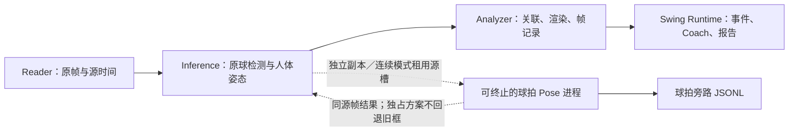

# 七关键点球拍 Pose 渐进集成指南

版本：v2.5，2026-10-18。适用工程：`tennis_analyzer`；模型开发工程：`yolo26pose-racket`。

本版本以实际代码与数值检查为依据。目标是改善二维球拍观测及归属，保留已有实时工作流。二维接近、骨架连线和模型一致性不能独立确认真实触球、物理握拍贴合或三维拍面方向。

## 1. 当前架构与兼容边界



保留原始三阶段流水线、球检测、人体姿态、镜像/时序恢复、控制面板和证据重放。报告仍在原后台线程刷新：事件改为复制后替换，避免重复拷贝整份历史；内部输出快照、事件历史与轨迹复用不可变负载，完整事件 JSON 以紧凑格式协作式流式写入，避免大段序列化长时间持有 GIL。公开 `snapshot()` 仍返回完整独立副本，历史事件、片段状态和语音更新均保留。旧版作为独立启动方案保留；新版独占会话不回退旧拍框。新增实现为 `racket_pose_detector.py`、`racket_pose_runtime.py`；模型库仅在推理相关进程中加载。

模式：

| 球拍模式 | 行为 |
|---|---|
| `legacy`（默认启动方案） | 不启动球拍 Pose 进程，沿用旧选拍与分析 |
| `exclusive`（新版启动方案） | 只使用七点模型的同源帧候选，不混入或回退旧拍框；主球筛选辅助也改用新候选；仅支持逐帧连续/离线处理 |
| `shadow`（兼容诊断） | 新模型只记录/展示，不改变旧选拍、事件或 Coach；旧实时模式不等待，连续/离线模式逐帧等待以保留对照 |
| `active`（兼容混合诊断） | 只采用通过门控的同源帧新观测；低质量候选仍可采用旧检测。连续/离线模式遇工作进程失败或超时明确停止 |

| 处理模式 | 行为 |
|---|---|
| `buffered`（新默认） | 启动前完成模型/界面预热；保留所有已解码帧，满槽等待，新球拍逐帧处理，不采用采样收据 |
| `realtime` | 按源节奏预览，允许跳过旧帧；增强额外等待最多 8 ms |
| `offline` | 本地视频完整逐帧分析；增强等待每帧结果，单帧 10 秒失败则明确停止 |

旧 `realtime` 旁路最多一项执行、一项待处理；新待处理帧可替换旧帧。`buffered/offline` 逐帧等待结果，不替换待处理任务，实际 stride 固定为 1。默认 queue 传输在父进程生成独立 RGB letterbox 副本；显式 shared_memory 仅在连续模式租用源槽，sidecar 检查代际并完成推理后才允许交给 Analyzer 回收，预处理移到 sidecar。迟到结果进入原帧旁路日志，不套到当前帧、不改写已发布事件。

## 2. 原模型异常与独立修复候选

原始 `models/racket_pose/racket_pose_yolo26m_fp16.mlpackage` 和 exp-007 `best.pt` 均保留，未覆盖。

发现两个问题：

1. 原始 PyTorch 检查点有 78 个非有限 BatchNorm 运行统计项；PyTorch 与 Core ML 均出现一段 3,600 个候选异常。这不是单独切换后端就能修复的问题。
2. 即使恢复 BN，极端的背景关键点网格偏移仍可能在 FP16 的坐标解码中溢出。仅过滤 NaN/Inf 不能证明完整性。

独立候选保留全部学习参数和原来有限的统计项，只以 444 张 **train** 图像重新估计丢失的统计项。导出时在 `*2`、`*stride` 之前将原始 XY 网格偏移限制在 `[-512,512]`。960 输入内的有效点不需要这样的极端偏移；饱和后的画外点仍然不可用于测量，绝不吸附到画面边缘。原生卷积保持 FP16。

当前配置引用：

- 模型：`models/racket_pose/candidates/bn-recalibrated-v1/racket_pose_validated_fp16.mlpackage`
- 验收：`models/racket_pose/candidates/bn-recalibrated-v1/acceptance-release.json`
- 修复参考权重：同目录 `bn_repaired_fp32.pt`
- 修复依据：同目录 `calibration.json`、`repair.json`

资产名称沿用上游命名；实际检查点使用 Ultralytics 的 legacy `Pose` 头，加载摘要为 YOLO11m-pose。实现按已检查的输入、七点拓扑及输出契约解析，不根据“YOLO26”文件名推断结构。

## 3. 输入、拓扑与观测契约

此包仅有一个 `tennis_racket` 类别与一个七点 Pose 输出头，不能同时输出人体 17 点。原始包及修复候选各对本地 250 帧、每帧一次 `predict` 的实测都只有下述单一输出。人体模型仍单独推理；两个身体实例分别处理正面和镜面，并非新旧版本各跑一套。验证记录：`data/analysis_results/racket_pose_acceptance_20261018/joint-output-check-20261018/index.html`。

Core ML 输入：`image`，RGB 960×960，模型内完成 1/255 缩放。外部采用居中 letterbox，保留逆变换。输出为一个 `[1,26,18900]` 原始候选张量；输出名字从模型规格读取，不硬编码 `var_2295`。

26 通道含 `cx,cy,w,h`、单类分数和 `7×(x,y,confidence)`，需要筛选与 NMS。

| 索引 | 关键点 |
|---|---|
| 0 | `butt_cap` 拍柄底盖 |
| 1 | `grip_center` 握持中心 |
| 2 | `throat` 拍喉 |
| 3 | `sweet_spot` 拍面网线几何中心 |
| 4 | `head_top` 拍头顶部 |
| 5 | `frame_left` 左拍框 |
| 6 | `frame_right` 右拍框 |

水平翻转拓扑为 `[0,1,2,3,4,6,5]`。反射视角、原图坐标和人物归属必须分别处理，不能仅交换左右名称后宣称三维恢复。

新增 FrameRecord 字段为 `racket_pose`、`legacy_rackets`、`racket_selection_source` 和 `inference_stage_ms`；既有 `rackets`、`racket`、帧号和源时间字段保留。观测携带源帧、源时间、原图坐标、逐点置信度、模型内容哈希及后端。原始新观测的视角标为 `source_frame`、归属为 `unassigned`；双视角当前手腕关联另标 `association_view: front`，不把原始镜像候选当成已确认的人物归属。任何非有限原始候选都会使该帧新观测失去增强资格。

默认检测阈值 0.25、关键点阈值 0.5；这些分数不是准确率概率。手腕关联按画面对角线归一化距离。双视角分支要求当前 `observed` 正面手腕及其置信度；单视角保留旧人体姿态 XY 输出（包含原有平滑），因此只能作为未验证的归属启发式，不能据此确认物理握持。原始观测、预测与镜像恢复不可混同。`contact_verified`、`person_assignment_verified` 保持 false；甜区距离只是二维候选证据。

## 4. 配置与使用

```yaml
racket_pose:
  mode: legacy
  model_path: models/racket_pose/candidates/bn-recalibrated-v1/racket_pose_validated_fp16.mlpackage
  acceptance_path: models/racket_pose/candidates/bn-recalibrated-v1/acceptance-release.json
  runtime_acceptance_path: models/racket_pose/candidates/bn-recalibrated-v1/pipeline-acceptance.json
  acceptance_run: false
  backend: coreml
  compute_units: ANE
  imgsz: 960
  confidence_threshold: 0.25
  keypoint_threshold: 0.5
  inference_stride: 1
  join_ms: 8
  timeout_seconds: 10
```

`mode` 是实际开关，不是早期示例的 `enabled`。增强启动会校验验收报告的模型哈希、后端、数值与同划分质量门槛。日常实时入口还必须匹配三轮整链路验收收据中的单/双视角配置、采样频率、输入尺寸和源帧率；`use_accepted_schedule: true` 会选用该视角配置已通过验收的最高频率，并在旁路 summary 中记录实际频率；未验收或不匹配时记录原因并保留旧链路。验收脚本会显式设置 `acceptance_run: true`，只允许测试未定案的性能配置，不能跳过模型数值与质量门控。默认 ANE 对应 `CPU_AND_NE`；`ALL` 需要单独验收，发生过原生崩溃的 `CPU_AND_GPU` 不会自动使用。

现有控制面板“性能与显示”提供球拍模式和处理方式。默认“连续处理”，球拍模式仍为旧版；旧的浏览器低延迟预设首次刷新时迁移到连续模式。完整分析仅对本地视频开放，旧的可丢帧实时预览仍可显式选择。连续模式覆盖旧 `--live-mode/--drop-stale-frames` 标志，不允许它们重新开启丢帧。

CLI 示例（每次使用新的输出路径）：

```bash
venv_yolo26/bin/python main_pipe.py \
  --input /Users/krum5539/Desktop/Camera/2026-09-30/48.43.mp4 \
  --output data/analysis_results/pose_trial_001/output.mp4 \
  --processing-mode buffered --racket-pose-mode shadow \
  --no-dual-view --realtime-swing-events --realtime-coach \
  --evidence-manifest data/analysis_results/pose_trial_001/evidence_manifest.json
```

对照后可将 `shadow` 改为 `active`；完整分析改为 `--processing-mode offline`。回退使用 `--racket-pose-mode legacy`，不会启动新模型。

完整分析也可以显式选用已验证的 PyTorch 参考后端：在独立运行配置中将 `backend` 设为 `pytorch`、`compute_units` 设为 `CPU`，`model_path` 指向候选目录的 `bn_repaired_fp32.pt`，`acceptance_path` 指向 `acceptance-pytorch.json`；配合 `--processing-mode offline --racket-pose-mode active`。不会自动切换后端或更换精度。

实时新进程加载失败、卡住、原生退出或输出不合格时，记录原因并停用本轮旁路，旧链路继续。完整分析增强失败会停止，不把降级结果冒充完整成功。`*_racket_pose.jsonl` 和 `*_racket_pose.summary.json` 记录结果、迟到/回退计数和原因，并纳入证据清单。

## 5. 验收与复现

验证素材为 `/Users/krum5539/Desktop/Camera/2026-09-30` 的 9 段 2560×1440 视频，每段 250 帧，约 25 FPS。首次三个片段为 `48.43`、`49.23`、`50.03`。冻结各次输入哈希与配置，虚拟双视角使用独立验收 fixture，不修改共享摄像头配置。

- 模型数值：9 段各 6 帧，共 54 帧；9 次同像素 PyTorch/Core ML 对照。
- 同划分指标：原模型 Pose mAP50–95 约 0.78377，最小修复候选约 0.78376；Box mAP50–95 约 0.63312 → 0.63365。
- 该划分 train/val 来自相同的 9 个任务，108 张 val 图中 72 张与 train 帧仅差一个索引；不能称“全盲”，`test` 也指向 val。
- 本机 Python 3.9 的不同进程单调时钟起点不一致，IPC 队列耗时使用跨进程系统时间；进程内超时仍使用本地单调时钟。早期记录中的队列耗时 0 不作为有效 IPC 测量；读取至输出的端到端统计使用系统时间，未受影响。
- 单模型约 25 ms 不代表整系统 40 FPS。整链路必须包含 IPC、原球检测、人体姿态、后处理、分析、渲染、编码与报告开销。
- 实时门槛：各片段输出 ≥24 FPS、读取至输出提交 P95 ≤250 ms、丢源帧 ≤5%；增强不能只靠全程旧版回退通过。
- 完整分析：全部 250 帧保留源身份和 PTS，证据重放语义一致。
- 稳定性：10 分钟本地循环推流，预热后内存增长 ≤10%；该推流只评价资源，不验证原始曝光时间或独立准确率。

验收脚本：

```bash
venv_yolo26/bin/python -m unittest test_racket_pose test_racket_pose_integration -v
venv_yolo26/bin/python scripts/validate_racket_pose_pipeline.py \
  --output data/analysis_results/pose_acceptance_new --mode active --save-video --repeats 3
venv_yolo26/bin/python scripts/stress_racket_pose_pipeline.py \
  --output data/analysis_results/pose_soak_new --seconds 600
```

`prepare_racket_pose_candidate.py --repair-only-invalid --export` 可在新目录重建候选；输入必须是原始权重和原划分训练图像。`validate_racket_pose_quality.py` 重测原 val 划分，`audit_racket_pose_model.py` 产生内容哈希绑定的模型验收报告。完整运行参数与测量文件保存在 `data/analysis_results/racket_pose_acceptance_20261018/`。

所有运行保留逐帧记录、配置、事件、校验值和测量结果；归档前逐文件核验哈希。为控制存储预算，保留正式首轮的新旧可视化对照及代表性失败视频，成功的中间/重复运行可省略可再生成的视频副本，省略项及原哈希记录在 `derivative_retention.json`，必需的证据重放文件始终保留。源素材、历史人工标注和现有备份不做覆盖或清理。默认继续使用旧版，验收不等同于自动切换生产配置。

## 6. 历史采样方案实测与启用边界

以下是旧 `realtime` 采样策略的历史结果，不代表连续模式达标。默认球拍仍为 `legacy`。历史运行收据为候选目录的 `pipeline-acceptance.json`；日常实时增强按收据自动采用单视角每两帧一次、双视角每三帧一次。每帧方案的最新复测曾出现 16.8% 丢帧，双视角每两帧方案只有 14/27 次通过，因此没有放行这两档。

| 实测配置 | 三轮通过 | 最低输出 FPS | 最差读取至输出 P95 | 最大源帧丢弃 |
|---|---:|---:|---:|---:|
| 单视角，stride 2 | 27/27 | 25.00 | 55.97 ms | 0.8% |
| 双视角，stride 3 | 27/27 | 24.91 | 98.41 ms | 2.0% |

- 9 段完整分析均为 250/250 帧，源身份与 PTS 保留，事件证据重放一致。
- 旧版与影子模式的 9 段稳定事件语义一致。
- 最终 10 分钟循环推流：稳定输出 24.81 FPS，P95 49.26 ms，Reader 已知丢帧 0.47%，预热后进程树 RSS 中位值变化 -10.04%，时延覆盖率 100.00%。RSS 包含共享页重复计数；不能据此保证无限时长无内存增长。
- 中间长测曾出现 RSS 增长 16.3% 和 20.4%、输出降速，已保留原始结果。修复采用共享不可变事件/轨迹及流式写完整历史，没有截断历史数据。
- 遇系统时钟回拨时，输出提交延迟可为 null；验收报告显式统计无效数和覆盖率，覆盖率低于 99.9% 不通过。资源采样及退出状态即时落盘，避免汇总故障丢失证据。
- 报告刷新、片段编码与本地 Coach 在上述实测中开启。语音 worker 不可用、网络连接失败在真实流水线中单独验证，主链路继续；语音成功路径由合成/播放器接口测试覆盖。真实 Qwen 语音模型并行运行的性能未在本轮声明通过，原可选开关保留。

对照入口：`data/analysis_results/racket_pose_acceptance_20261018/comparison.html`；完整测量、旧失败样例、输入哈希、模型版本与收据均保留在该目录。输入是同一套已有工程素材，不作为独立泛化准确率证明。

最终补充核查：149 项测试通过；关闭实验性验收旁路后，日常 CLI 入口单/双视角各 3 段全部通过，实际频率分别为 stride 2 / stride 3。验收记录约 1.67 GiB，保留的候选与参考模型约 0.20 GiB；合计约 1.87 GiB。大体积循环推流 JSONL 采用无损 gzip，并逐文件核对解压后的 SHA-256，映射在 `compressed-records.json`。重复视频及实验导出清理映射分别在 `derivative_retention.json` / `experimental-export-inventory.json`。


## 7. 连续处理与瓶颈优化（2026-10-18 晚间）

用户明确接受首帧等待，但不接受跳过处理帧。新默认 `buffered` 保留 Reader → Inference → Analyzer → Swing Runtime；模型和窗口就绪后才开始读取源帧，共享内存仍为三个槽。满槽背压等待，不再 `grab()` 跳帧、不重置落后的输入节奏，新球拍每帧等待同源结果。工作进程失败/超时会使完整运行失败，不能标成降级成功。`legacy` 不启动新球拍进程。

HighGUI 移入独立可终止进程：一项执行、一项待处理，输入图像独立复制，默认背压保留全部预览帧，正常 EOF 排空后退出。逐帧 `output_display.jsonl` 单独记录 HighGUI 返回时刻，并进入证据清单。它不是物理屏幕呈现或相机曝光时刻。ESC/主动取消允许提前停止，不属于完整成功。

修复双人体姿态实例没有收到顶层 `pose_compute_units` 的问题。原双视角实际一直使用 ALL；配置现显式设为 ALL，日志记录实际后端与请求计算单元。锁定 ANE 的对照未更快。显式 GPU 检测器对照发生 MPSGraph MLIR 原生断言，退出 -6，不启用此配置；CPU 和限制 OpenCV 线程也没有解决瓶颈。新球拍仍使用独立验证的 ANE 包，原始交付模型不变。

三段本地素材 `48.43 / 49.23 / 50.03` 的连续增强复测均完成 **250 个源帧、250 次新模型结果、250 次显示记录和 250 个编码帧**，PTS 保留，事件/本地 Coach 证据重放一致。持续速度约 **19.12–19.69 FPS**，十秒片段的局部输入节奏到输出延迟增长约 **2.39–2.67 秒**，故 **没有通过无丢帧 25 FPS 实时门槛**。旧版同条件约 23.39–25.13 FPS，系统负载有波动；这是顺序工程回归，不能将小幅配置差异当成稳定收益。

异步显示使 Analyzer 的显示提交中位数从约 14 ms 降至不足 1 ms。当前主要瓶颈转到多个模型的并发推理：增强下检测和双人体姿态阶段中位数约 46–48 ms；它们并行，不能相加计算帧时长。新球拍单模型耗时不能代表全链路吞吐。资源争用与后端等待仍需独立剖析，不能凭配置名称断言实际 ANE/GPU 占用比例。

`reader_schedule_lag_ms` 和报告里的局部输入节奏延迟使用预热结束后的名义 FPS 调度时钟，独立于源 PTS，不把它们标成曝光延迟。启动、读取至输出、积压增长、HighGUI 返回分开记录；短片三段连续性通过不等同于九段三轮或十分钟连续性能通过。报告刷新、片段编码、本地 Coach 和保存视频保持开启，本轮没有声明真实语音模型/网络旁路并发性能通过。

报告：`data/analysis_results/racket_pose_acceptance_20261018/timing-analysis-20261018/pipeline-bottlenecks.html`。实现决策见 `docs/adr/0004-continuous-buffered-processing.md`。历史收据和旧结果保留，不能用历史采样验收放行连续实时性能。


## 8. 启动时固定旧版／新版（七点独占）

原控制台的“启动时选择球拍方案”提供旧版／新版两个主选项；历史影子与混合增强保留在“兼容诊断”组。修改选项只在下次启动生效，不热切换当前会话。默认仍旧版。

```bash
# 旧版：球拍观测来自原统一检测器，不启动七点进程
venv_yolo26/bin/python main_pipe.py --processing-mode buffered --racket-pose-mode legacy
# 新版：球拍观测只来自七点模型；保留球检测、双人体、Analyzer、Coach 与证据流
venv_yolo26/bin/python main_pipe.py --processing-mode buffered --racket-pose-mode exclusive
```

也可在独立运行 YAML 中设置 `racket_pose.mode: exclusive`。内部将其解析为 `mode: active, selection_policy: exclusive`；这两个字段及 `exclusive_grip_views_v1` 来源策略版本一同写入模型身份、逐帧记录、运行 summary 和证据 capture。`--processing-mode realtime` 与独占方案不兼容，CLI/API 会拒绝，控制台会使用连续处理，避免偷偷采样或丢源帧。

新版统一检测器仍执行一次球／框共享前向，因为当前还需要它检测球。但旧球拍框不再进入主球辅助、主拍挑选、时序或镜像候选池，也不作为缺失回退。主球静态抑制／连续性筛选延后至新球拍结果到齐后执行一次，仅使用新候选作为球拍支撑；完整保留原来的主球跟踪与镜面/ROI过滤。

七点候选先分别通过正面／镜面当前手腕与握持点门控，保持原有关键点阈值（默认 0.5）、源帧身份和归一化距离条件，不放宽到只看框。通过门控的正面／镜面候选再由原 `RacketResolver` 与人体/时序关系选拍；镜面关联候选不直接充当前景观测。镜中恢复和短时平滑继续保留。镜中投影是派生框，不会伪造七点，标记 `observed: false, measurement_eligible: false`，源仍为七点模型；原始七点与源帧保存在旁路。无候选时明确缺失或使用标明来源的派生结果，不恢复旧拍框。后续解算如果泄漏旧来源或把迟到观测当当前帧，会显式使运行失败。

独占方案要求新模型每帧对应结果；工作进程失败、输出非有限或单帧十秒超时使增强会话失败，不自动切回旧版。旧版可另行启动。`legacy_rackets` 兼容字段在独占记录中保留为空列表；`racket_selection_policy: exclusive`、主球诊断 `racket_support_source: racket_pose_model` 以及逐帧原始/派生来源用于验收。

只移除候选混用并不会省掉整次旧模型计算。新方案仍为一个球／框共享检测、两个身体姿态实例和一个新球拍实例，不能把这项逻辑隔离当成 25 FPS 性能放行，也不能把“更多帧选择新候选”解释为准确率提高。性能与独占来源的实测报告：`data/analysis_results/racket_pose_acceptance_20261018/startup-profiles-20261018/index.html`。

## 两阶段跨帧与共享源帧实验（2026-10-18）

默认仍为旧版球拍、`barrier` 调度和 `queue` 图像传输。控制台新增两个启动选项，
不支持会话内热切换。新版独占连续处理可显式试验：

```bash
venv_yolo26/bin/python main_pipe.py --input /path/to/video.mp4 \
  --racket-pose-mode exclusive --processing-mode buffered \
  --racket-ipc shared_memory --inference-schedule interframe
```

共享传输直接借用 Reader 源图槽，检查代际并保持至球拍结果完成；预处理仍有必要的
resize/RGB/model-input 转换。跨帧准备仅提前原始候选和球拍，不提前动态人体裁剪，
所有时序状态按源帧顺序更新。两帧在途、有界背压、正常结束排空，不采样、不替换帧。

用 `scripts/benchmark_interframe_pipeline.py --output <新目录>` 可轮换顺序比较
queue/barrier、shared/barrier、shared/interframe，默认三段原视频并保留编码和显示。
这只是核心链路工程对照，外部网络/语音关闭；不能替代完整工作流和三轮实时验收。
实测通过前不承诺 25 FPS。详见 ADR 0006。

### 本轮实测结果

三段各一轮，三组共 2250 帧，另有旧版、单人体和旁路故障各 250 帧冒烟。
主对照源帧／PTS、人体观测、球选择、球拍、运动学字段和事件语义逐帧一致；
全部处理、编码、显示、证据重放完整。204 项回归测试通过。

| 配置 | 三段输出 FPS 中位数 | 父进程派发 P50 | 球拍队列 P50（含调度） |
|---|---:|---:|---:|
| 同帧＋queue | 20.54 | 0.648 ms | 2.193 ms |
| 同帧＋shared_memory | 20.26 | 0.130 ms | 0.086 ms |
| 跨帧＋shared_memory | 20.83 | 0.052 ms | 0.206 ms |

跨帧准备与聚合阶段各约 46／47 ms，尚未恢复到 30–33 ms。
本轮没有稳定吞吐提升，25 FPS 未通过，默认保持 barrier＋queue。
单轮顺序对照仍受系统负载影响；网络／语音冒烟验证失败隔离，不能代替真实旁路并发性能测试。
报告：`data/analysis_results/racket_pose_acceptance_20261018/interframe-20261018/index.html`。
可用 `scripts/summarize_interframe_pipeline.py <实验目录>` 重新审计和生成报告。
